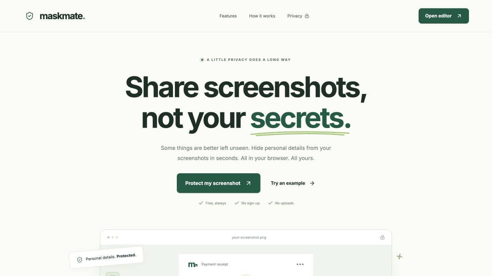
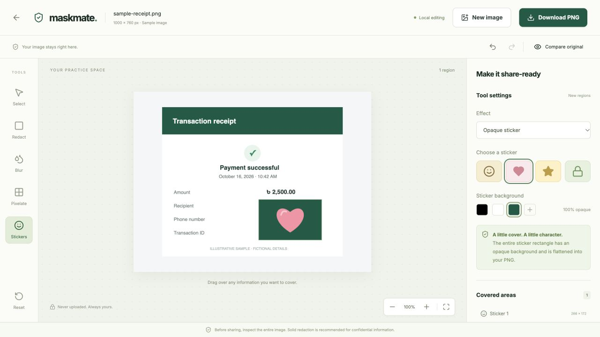
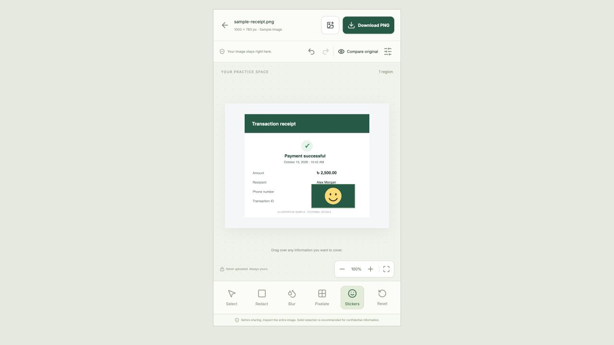

# MaskMate

**Share screenshots, not your secrets.** A free browser-based screenshot privacy editor built with React, TypeScript, and Canvas. No application account, backend, database, image upload, or persistent image storage.

## Why it exists

Screenshots can expose phone numbers, addresses, transaction references, student IDs, private messages, and QR codes. MaskMate lets users manually cover those details and generate a new PNG on their own device.

## Features

- Responsive landing page with a working illustrative demo and clear privacy guidance.
- PNG, JPEG, and WebP input through file selection, drag/drop, or clipboard paste.
- 20 MB input limit; 24 megapixels and 16,384 pixels per side. Common headers are checked before decoding and decoded dimensions are checked afterward.
- Solid black, white, or custom opaque redaction; adjustable blur and mosaic pixelation.
- Smile, heart, star, and lock stickers with opaque backgrounds, style/color controls, resizing, and flattened PNG export.
- Multiple original-pixel regions; select, move, resize, change effects, and delete.
- Immutable undo/redo, reset confirmation, and original/edited comparison.
- Zoom and fit-to-screen; touch-compatible Pointer Events, mobile bottom toolbar, and settings drawer.
- Full decoded resolution PNG export, with no selection handles or editable redaction layers.
- Optional manual privacy checklist for payment, chat, academic, job, and general screenshots.

## Screenshots





The receipt contains fictional example details.

## Local development

Use Node.js 22.12 or later and npm.

```sh
npm ci
npm run dev
```

Open the printed local URL. Routes are `/` and `/editor`; refreshing the editor returns to its upload state because images live only in memory.

```sh
npm test       # Vitest pure-function tests
npm run lint   # ESLint + React hooks
npm run build  # strict TypeScript + Vite
npm run preview
```

With the development server running, open `/tests/browser.html` for real Canvas pixel, decode, and PNG checks. Open `/tests/responsive.html` for a 390 × 660 CSS-pixel mobile viewport review. These QA pages are excluded from production output. The browser checks are intentionally local and do not transmit test image bytes.

## Stack and architecture

React, TypeScript, Vite, Tailwind CSS, a shadcn-style Radix Button, Lucide icons, Sonner, and native Canvas APIs. Inter fonts are self-hosted with their license.

The decoded `ImageBitmap` remains unmodified. Regions store source-image coordinates, independent of viewport zoom. The canvas rerenders when committed edits change; live selection borders use a separate DOM layer. Move and resize gestures each create one history entry. The history retains up to 50 prior region snapshots, not image copies.

The renderer draws the source, applies blur/pixelation, draws stickers on fully opaque rectangular backgrounds, and then fills every solid redaction in a final opaque pass. Preview and export share the same renderer. Export uses a new full-size canvas and `toBlob('image/png')`, with delayed Blob URL revocation. Bitmap and temporary-canvas resources are released after replacement/export.

## Privacy and security

- Image bytes stay in browser memory; application code makes no upload/API requests.
- No localStorage, IndexedDB, analytics, third-party OCR, or remote fonts.
- Sticker artwork always has an opaque rectangular backing. The entire selected area is flattened into the PNG, including corners outside the artwork.
- Source images are not embedded in URLs or copied to the export as editable layers.
- **Use solid redaction for confidential information.** Blur and pixelation are visual effects and can leave information recoverable.
- Export does not deliberately copy original metadata. A synthetic EXIF/GPS-bearing PNG chunk is checked for non-propagation; this is not a universal metadata-removal guarantee.
- Review the complete exported image, including names, pictures, QR codes, and surrounding context, before sharing.
- The hosting provider may handle normal website access data. This application's local-image claim concerns screenshot bytes, not absolute anonymity.

## Project links

- [Repository](https://github.com/touhid404/maskmate)
- [Hosted preview](https://maskmate-screenshot-privacy.spunky-shark-2321.chatgpt.site) — owner-private Sites deployment; Vercel can host the public application using the steps below.
- [Quality checks](https://github.com/touhid404/maskmate/actions/workflows/ci.yml)

## Deploy on Vercel

1. Import `touhid404/maskmate` in Vercel and allow access to this private repository.
2. Use the **Vite** preset with repository root `.`.
3. Set install command `npm ci`, build command `npm run build`, output directory `dist`, and Node.js 22.
4. Deploy. No environment variables, database, or backend are required.
5. Test upload → cover → compare → download at the generated URL. Verify a direct `/editor` refresh opens the upload state.
6. Optionally configure a domain in Vercel and add the exact deployed origin to canonical/Open Graph URL metadata. No domain or canonical URL has been guessed.

`vercel.json` contains SPA rewrites and basic response headers. The tracked `.openai/hosting.json` also supports a Sites-hosted preview. A private Sites deployment may require the owner to sign in to access the preview; the application itself has no account system.

## Validation and limitations

See [QA report](docs/QA.md) for actual checks and their limits. Physical mobile touch, real-camera EXIF orientation fixtures, and a full cross-browser matrix still need device testing. Large-image performance depends on device memory; native Canvas blur has a portable three-box Gaussian approximation fallback. Header preflight recognizes common PNG/JPEG/WebP layouts and cannot eliminate all decoder allocation risks. There is no OCR, auto-detection, arbitrary-angle selection, region rotation, freehand masking, or session recovery.

## Future improvements

Locally bundled OCR suggestions, richer keyboard geometry controls, worker-based processing for large images, a camera EXIF fixture suite, and automated multi-browser UI coverage.
